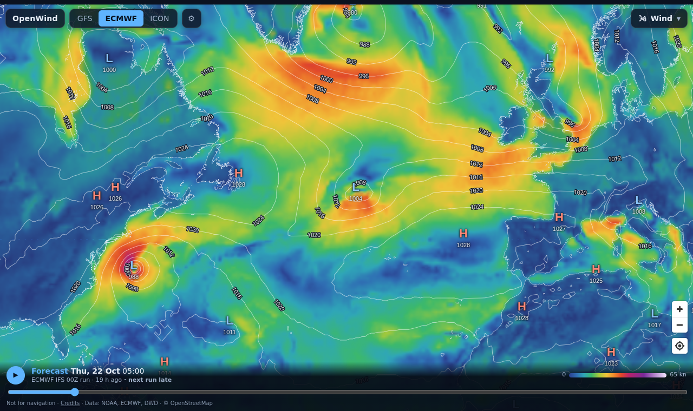
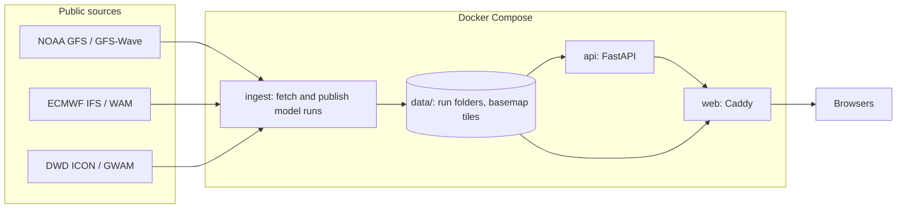

# OpenWind

A marine weather map built only from free public forecast models. It shows the raw output of several models
side by side (never blended, always labelled by model and run): wind, gusts, pressure, rain, temperature,
cloud, visibility, storms, the jet stream, waves, swell and ocean currents, drawn on the device with
animated particles.



> **Not for navigation.** Forecasts are raw model output from external services and their accuracy is not
> guaranteed. Use your national weather service's official forecasts and warnings for decisions at sea.

## Features

- **Map:** wind with isobars and highs and lows, gusts, rain (rate and next 24 hours), temperature, cloud,
  visibility, storms (CAPE), jet stream, waves, swell and currents, shaded on the device. Particles can show
  a second field over the colours (wind over currents, for example).
- **Models:** NOAA GFS and GFS-Wave, ECMWF IFS and WAM, DWD ICON and GWAM. Pick a model; layers a model
  lacks come from one that has them, and the timeline says so.
- **Point chart:** tap anywhere for hour-by-hour wind and gusts from every model on one set of axes, plus
  waves and ECMWF currents. On a computer, resting the pointer shows the values under it.
- **Satellite overlay:** the latest geostationary infrared from NASA GIBS.
- **Settings:** wind in kn, m/s, km/h or mph; °C or °F; times in the device's zone or UTC.

## How it fits together



Details: [docs/architecture.md](docs/architecture.md).

## Running it

Needs Docker with Compose, and Node 22 to build the web app. A server with 4 CPUs, 8 GB of memory and about
60 GB of disk is comfortable: all six models with two runs each (up to about 40 GB) and the basemap (about
10 GB, in some 2.5 million small files, so the disk needs the inodes for them too).

```sh
(cd web && npm ci && npm run build)   # the web app, into web/dist
infra/basemap/refresh.sh               # land and coastline tiles from OpenStreetMap (about 1.8 GB download)
docker compose up -d --build           # ingest, API and web server
```

Open http://127.0.0.1:8080. The first model runs arrive within about half an hour (the ingest checks every
ten minutes; a full run takes a few minutes to download). Serving it to others, HTTPS and updates are in
[docs/operations.md](docs/operations.md).

## Development

Needs Python 3.13 with [uv](https://docs.astral.sh/uv/), and Node 22.

```sh
uv sync                                                        # Python dependencies
OPENWIND_DATA_DIR=./data uv run python -m openwind.ingest gfs  # fetch the latest GFS run (a few minutes)
OPENWIND_DATA_DIR=./data uv run uvicorn openwind.api:app       # API on :8000
python3 -m http.server 8099 -d data                            # run files and tiles on :8099 (Caddy's job in production)

cd web && npm ci && npm run dev                                # map on :5173, proxying to the two above
```

Run `scripts/check.sh` before every commit (`--fast` while iterating). See [CONTRIBUTING.md](CONTRIBUTING.md).

## Documentation

| Document | What it covers |
|---|---|
| [docs/architecture.md](docs/architecture.md) | Services, data flow, storage layout, frontend structure, design decisions |
| [docs/operations.md](docs/operations.md) | Running, configuration, HTTPS, monitoring, updates, troubleshooting |
| [docs/data-sources.md](docs/data-sources.md) | Every source, its resolution and cadence, licence and attribution |
| [SECURITY.md](SECURITY.md) | Hardening and threat model |
| [CONTRIBUTING.md](CONTRIBUTING.md) | Code standards, checks and workflow |
| [CHANGELOG.md](CHANGELOG.md) | Release history |

## Repository layout

```
openwind/        Python package: model sources, ingest, run store, API
tests/           pytest suite
web/             React + TypeScript + MapLibre app (Vite); static pages in web/public
infra/           Caddyfile, basemap build
scripts/         check.sh, every check before a commit
compose.yaml     The services
LICENSE          MIT
```

## Data and licences

Model data: NOAA (public domain); ECMWF and DWD (CC BY 4.0, contains modified data). Map data
© OpenStreetMap contributors (ODbL). Satellite imagery: NASA GIBS, NOAA GOES, JMA Himawari. Full list with
attributions: [docs/data-sources.md](docs/data-sources.md) and the site's `/credits.html`. If you run a public
copy, keep those attributions visible.

## Licence

The code is under the [MIT License](LICENSE). The data it fetches and displays keeps its own licences, above.
